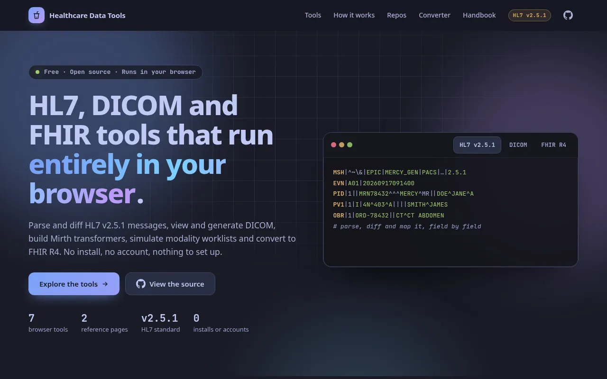
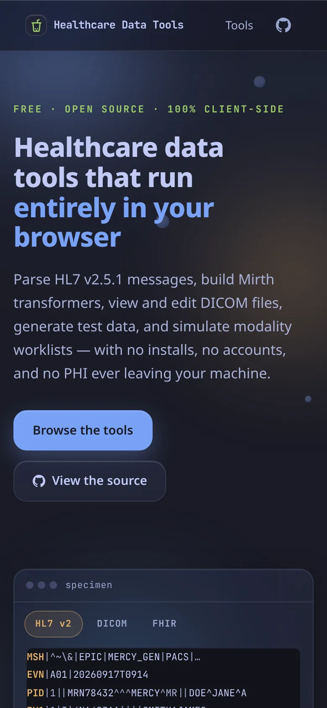
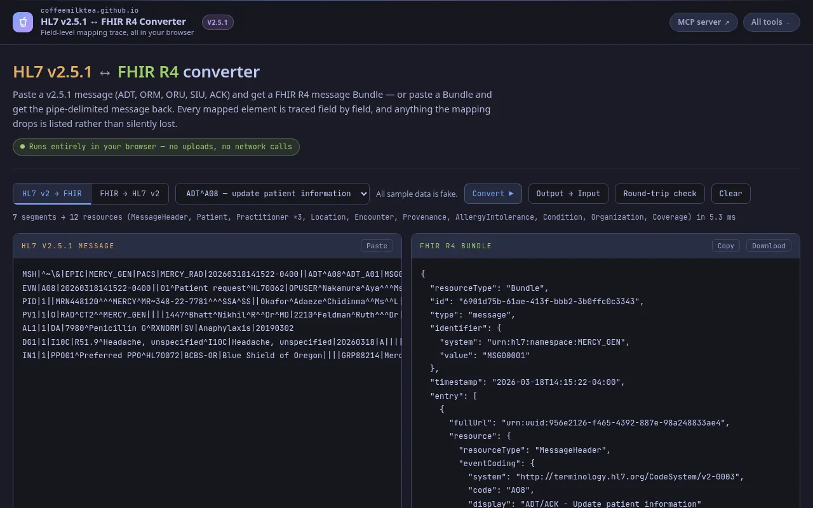
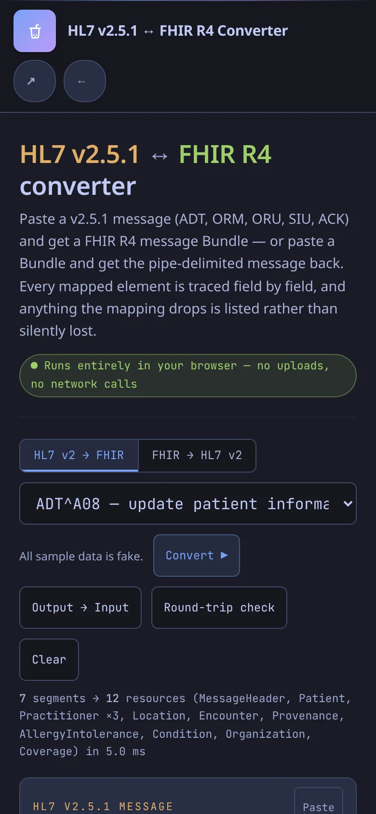
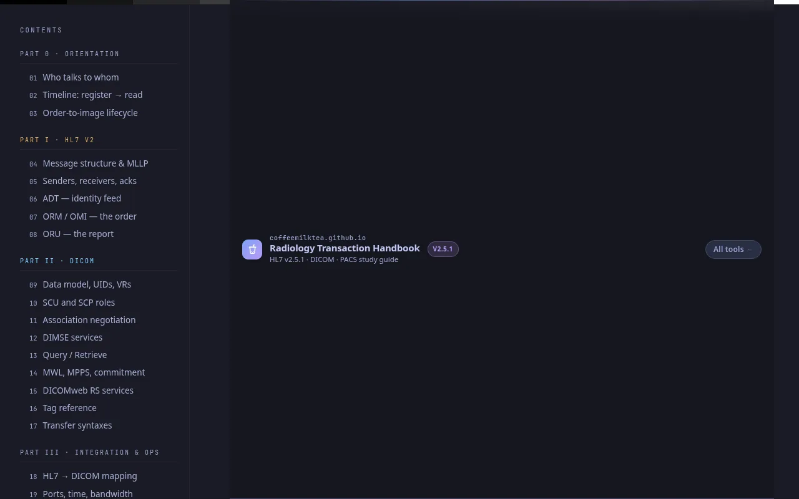
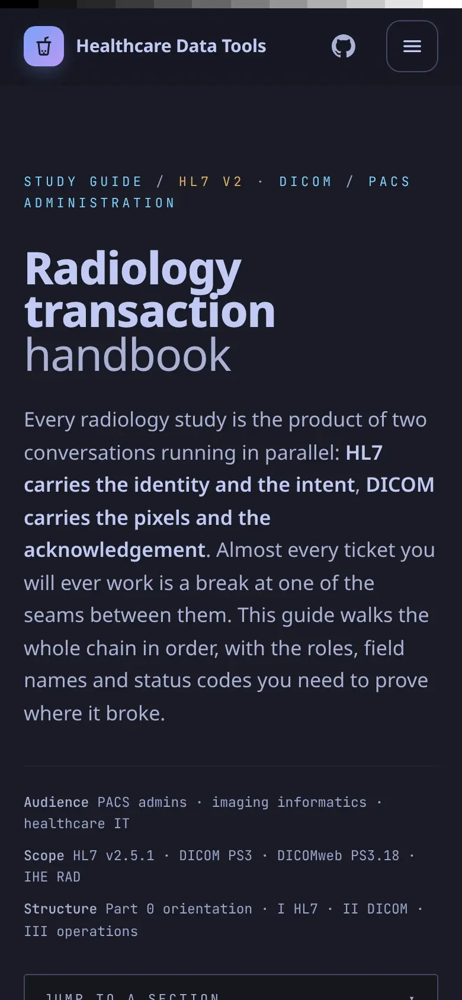

# Healthcare Data Tools

Landing page and reference pages for free, browser-based HL7 v2.5.1, DICOM and FHIR tools.

**Live:** [coffeemilktea.github.io](https://coffeemilktea.github.io/)

## Pages

| Page | Desktop | Mobile |
|---|---|---|
| **[Landing page](https://coffeemilktea.github.io/)**: the tool catalogue, with category filters and expandable use-case panels (htmx). · [`index.html`](index.html) |  |  |
| **[HL7 v2.5.1 ↔ FHIR R4 Converter](https://coffeemilktea.github.io/hl7-fhir-converter.html)**: converts HL7 v2.5.1 messages (ADT, ORM, ORU, SIU, ACK) to FHIR R4 message Bundles and back, with a field-level mapping trace, a report of anything that couldn't be mapped faithfully, and a round-trip check. · [`hl7-fhir-converter.html`](hl7-fhir-converter.html) |  |  |
| **[Radiology Transaction Handbook](https://coffeemilktea.github.io/radiology-handbook.html)**: a reference for PACS administrators covering the order-to-image timeline, HL7 ADT/ORM/ORU, DICOM SCU/SCP roles, DIMSE, DICOMweb, tags, ports and troubleshooting. · [`radiology-handbook.html`](radiology-handbook.html) |  |  |

The landing page links to these tools:
- the six tools in [hl7-dicom-tools](https://github.com/coffeemilktea/hl7-dicom-tools) (HL7 Parser, HL7 Diff Checker, DICOM → HL7 Order, DICOM Toolbox, DICOM Viewer & Tag Morph, MWL Simulator)
- the Mirth Transformer Builder ([HL7-Interface-Javascript-Builder](https://github.com/coffeemilktea/HL7-Interface-Javascript-Builder))

## Features

- No build step and no Jekyll (`.nojekyll`): files are served exactly as committed.
- The landing page uses htmx 2.0.7, vendored in `vendor/` (no CDN). Apart from that and the small shared `tools/theme.js`, it has no custom JavaScript.
- Dark Tokyo Night theme from `assets/tokyo-night.css`, byte-identical to the copy in hl7-dicom-tools, so the site and the tools look the same.
- Mobile-friendly: 16px inputs on touch screens, 44px tap targets, wide tables and code blocks scroll inside their own box, and safe-area insets are respected.

## HL7 standard: v2.5.1

The converter reads and writes HL7 **v2.5.1**: it warns when an input's MSH-12 is a different version, and it always writes `2.5.1` to MSH-12 when converting from FHIR. The handbook's examples use v2.5.1 too.

## Privacy

Everything runs client-side. The converter and the handbook make no network requests with your data: messages and Bundles are converted in your browser.

## Local development

```bash
git clone https://github.com/coffeemilktea/coffeemilktea.github.io.git
cd coffeemilktea.github.io
python3 -m http.server 8000   # open http://localhost:8000/
```

Use HTTP, not `file://`. htmx fetches the `partials/` fragments with XHR, and pages reference `/assets/`, `/tools/`, `/vendor/` and `/partials/` by root-absolute path. See [CLAUDE.md](CLAUDE.md) for the file layout and theme rules.

## Tech

- Static HTML, CSS and JavaScript, plus htmx for the landing page's panels.
- `assets/tokyo-night.css`: palette and base components. `assets/tokens.css`: site chrome. `tools/theme.js`: shared helpers.
- Published with GitHub Pages from `master`.
